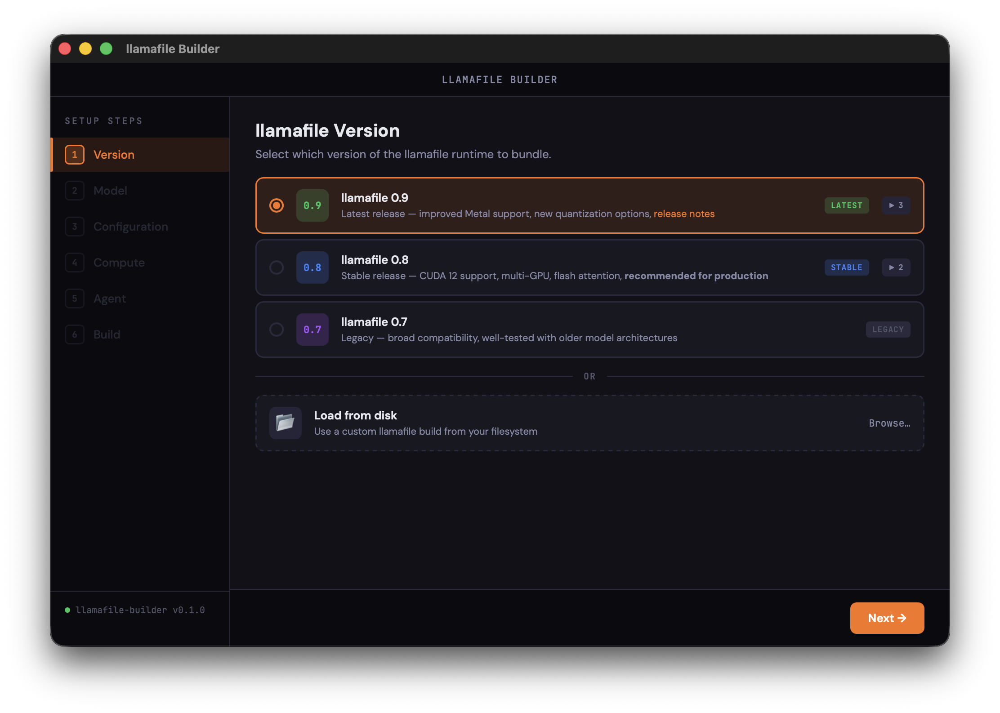

# llamafile Builder

A desktop application for building custom [llamafiles](https://github.com/Mozilla-Ocho/llamafile) with bundled models and configurations.



## Features

- **Version Selection** — Choose from stable, latest, or legacy llamafile runtime versions
- **Model Browser** — Search and filter models from Hugging Face with various quantization options
- **Configuration** — Set server parameters (host, port, context length, threads, etc.)
- **Compute Target** — Build CPU-only or GPU-accelerated (CUDA, ROCm, Metal) llamafiles
- **Agent Mode** — Create agentfiles with bundled tools and custom system instructions
- **One-Click Build** — Downloads weights, bundles runtime, and creates a single executable

## Prerequisites

- [Rust](https://rustup.rs/) (1.70+)
- [Node.js](https://nodejs.org/) (18+) — optional, only for frontend development
- Platform-specific dependencies for Tauri:
  - **macOS**: Xcode Command Line Tools
  - **Linux**: `libwebkit2gtk-4.0-dev`, `libssl-dev`, `libgtk-3-dev`, `libayatana-appindicator3-dev`
  - **Windows**: Microsoft Visual Studio C++ Build Tools

## Development Setup

```bash
# Clone the repository
git clone https://github.com/your-org/llamafile-builder.git
cd llamafile-builder

# Install Tauri CLI
cargo install tauri-cli

# Run in development mode
cargo tauri dev
```

The app will open with hot-reload enabled for frontend changes.

## Installation from Snap

### Install from Snap Store

```bash
# Install the snap
snap install llamafile-builder

# Grant home directory access (required for accessing ~/.ollama, ~/.cache/huggingface)
snap connect llamafile-builder:home

# Optional: Grant external drive access
snap connect llamafile-builder:removable-media

# Optional: Enable opening URLs in browser
snap connect llamafile-builder:browser-support
```

### Required Permissions

The snap uses **strict confinement** for security. Most permissions auto-connect, but home directory access requires manual connection:

| Permission | Required? | Auto-Connect? | Command |
|------------|-----------|---------------|---------|
| Home directory | Yes* | No | `snap connect llamafile-builder:home` |
| External drives | Optional | No | `snap connect llamafile-builder:removable-media` |
| Open browser URLs | Optional | No | `snap connect llamafile-builder:browser-support` |
| Network (downloads) | Yes | Yes ✓ | Auto-connected |
| Desktop UI | Yes | Yes ✓ | Auto-connected |

\* Required for accessing Ollama models (`~/.ollama`) and HuggingFace cache (`~/.cache/huggingface/token`)

### File Access in Snap

When running as a snap:
- ✅ **Downloads:** Use file picker to select download directories
- ✅ **Model import:** Access `~/.ollama` and `~/.cache/lm-studio` after connecting `home` plug
- ✅ **HuggingFace token:** Automatically reads from `~/.cache/huggingface/token`
- ✅ **Temp files:** Snap has its own isolated temp directory
- ✅ **App cache:** Managed in snap-specific directories

## Building for Production

```bash
# Build optimized release binary
cargo tauri build
```

Binaries will be output to `src-tauri/target/release/bundle/`.

## Project Structure

```
llamafile-builder/
├── src/                    # Frontend (HTML/CSS/JS)
│   ├── index.html
│   ├── styles.css
│   └── app.js
├── src-tauri/              # Rust backend
│   ├── Cargo.toml
│   ├── tauri.conf.json
│   └── src/
│       ├── main.rs         # Entry point
│       ├── commands.rs     # Tauri command handlers
│       ├── models.rs       # Data structures
│       ├── download.rs     # File download with progress
│       └── builder.rs      # llamafile assembly logic
└── README.md
```

## Architecture

### Frontend

Pure HTML/CSS/JS with no build step. The UI is a multi-step wizard inspired by Raspberry Pi Imager:

1. **Version** — Select llamafile runtime version
2. **Model** — Choose model weights and quantization
3. **Configuration** — Set runtime parameters (`.args` file)
4. **Compute** — CPU-only or GPU with library selection
5. **Agent** — Optional agentfile mode with tools
6. **Build** — Review and execute

### Backend

Rust + Tauri handles:

- Fetching llamafile versions from GitHub releases
- Downloading model weights from Hugging Face (with progress reporting)
- Generating `.args` configuration files
- Bundling GPU libraries (CUDA, ROCm, Metal)
- Creating the final executable via zipalign

### Communication

Frontend ↔ Backend communication uses Tauri's IPC:

```javascript
// Frontend: invoke a command
const versions = await invoke('get_llamafile_versions');

// Frontend: listen for events
listen('build-progress', (event) => {
  updateProgressUI(event.payload);
});
```

```rust
// Backend: define a command
#[tauri::command]
async fn get_llamafile_versions() -> Result<Vec<LlamafileVersion>, String> {
    // ...
}

// Backend: emit an event
app_handle.emit_all("build-progress", &progress)?;
```

## Configuration

### Server Options (`.args` file)

| Option | Description | Default |
|--------|-------------|---------|
| `--host` | Network interface to bind | `127.0.0.1` |
| `--port` | HTTP server port | `8080` |
| `-c` | Context length (tokens) | `4096` |
| `-t` | CPU threads | auto |
| `-b` | Batch size | `512` |
| `--api-key` | Require API key | none |

### Compute Targets

| Target | Size Overhead | Platforms |
|--------|---------------|-----------|
| CPU Only | ~5 MB | x86_64, ARM64 |
| CUDA 12 | ~180 MB | NVIDIA GPUs |
| ROCm 6 | ~60 MB | AMD GPUs |
| Metal | ~10 MB | Apple Silicon/Intel Macs |

## Roadmap

- [ ] Custom model URL input (local GGUF files)
- [ ] Quantization selection per model
- [ ] Model preview/info panel
- [ ] Build history and presets
- [ ] Auto-update for new llamafile versions
- [ ] MCP server tool integration for agentfiles

## License

MIT

## Acknowledgments

- [llamafile](https://github.com/Mozilla-Ocho/llamafile) by Mozilla Ocho / Justine Tunney
- [Tauri](https://tauri.app/) for the lightweight desktop runtime
- [Hugging Face](https://huggingface.co/) for model hosting
